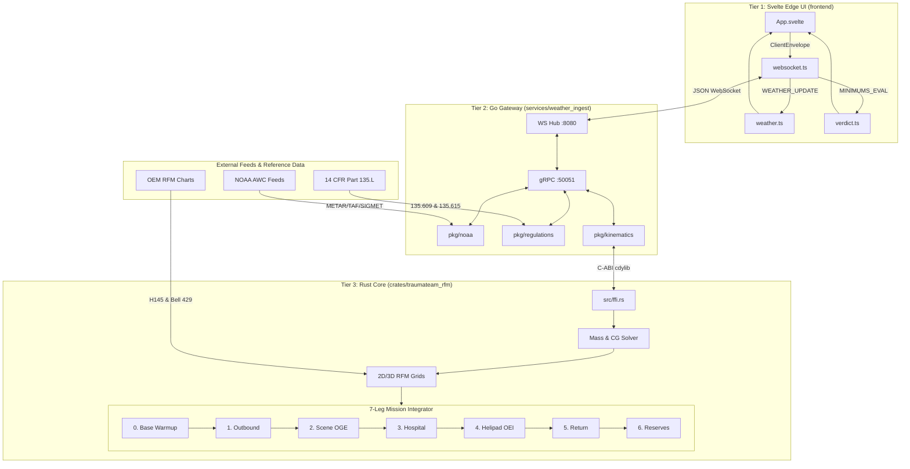

# TraumaTeam: Deterministic HEMS Mission Feasibility & Dispatch Engine

[](https://github.com/Cappuccino-san/Trauma-Team/actions/workflows/ci.yml)
[](https://cappuccino-san.github.io/Trauma-Team/)
[](https://www.python.org/)
[](https://www.rust-lang.org/)
[](https://go.dev/)
[](https://svelte.dev/)
[](LICENSE)
[](https://www.ecfr.gov/current/title-14/chapter-I/subchapter-G/part-135/subpart-L)

**TraumaTeam** is an aviation flight operations engineering and dispatch decision engine purpose-built for Helicopter Emergency Medical Services (HEMS) operating under **FAA 14 CFR Part 135 Subpart L** (§§ 135.601–135.621), Part 91, and Part 135 Subpart D.

> **Live Dispatcher Console (GitHub Pages):** [https://cappuccino-san.github.io/Trauma-Team/](https://cappuccino-san.github.io/Trauma-Team/) (Standalone HUD: [traumateam_console.html](https://cappuccino-san.github.io/Trauma-Team/traumateam_console.html))

Rather than relying on simplified rule-of-thumb weight or static ceiling thresholds, TraumaTeam integrates raw OEM Rotorcraft Flight Manual (RFM) multi-dimensional tabular charts with real-time aeronautical and meteorological feeds (NOAA AWC METAR, TAF, Winds Aloft, SIGMETs) and terrain profiles.

---

## Quickstart

TraumaTeam supports multiple operational workflows ranging from single-command polyglot testing to an interactive flight dispatcher CLI, a zero-dependency offline web console, and a containerized microservice stack.

### 1. Single-Command Polyglot Setup & Test
TraumaTeam unifies Python, Rust, Go, and Svelte under a single master Makefile. Run all test suites 100% offline with zero external network dependencies:

```bash
# Clone the repository
git clone https://github.com/Cappuccino-san/Trauma-Team.git
cd Trauma-Team

# Execute all 4 test suites (Python pytest/Hypothesis, Rust cargo test, Go E2E, Svelte vitest)
make test
```

### 2. Interactive CLI Demonstration Runner
Run the multi-scenario HEMS dispatch benchmark suite directly from your terminal:

```bash
# Using Make
make demo

# Or directly via uv:
uv run traumateam-demo
# or:
uv run python demo_dispatch.py
```

### 3. Python Package CLI
TraumaTeam installs as a first-class CLI tool (`traumateam`) via `uv` or `pip`:

```bash
# Display general help and subcommands
uv run traumateam --help

# Query OEM airframe specifications (Airbus H145 / BK117 D-2, Bell 429)
uv run traumateam airframe --type H145

# Inspect FAA 14 CFR Part 135 Subpart L VFR weather minimums
uv run traumateam regulations --mountainous --night --no-nvg
```

### 4. Standalone Zero-Dependency Avionics Web Console
For remote bases or disconnected emergency operations, TraumaTeam includes `traumateam_console.html`—a zero-dependency, single-file interactive HUD featuring real-time SVG CG envelopes, route mapping, and dispatch sliders:

```bash
# Open directly in your default browser:
xdg-open traumateam_console.html   # Linux
open traumateam_console.html       # macOS
```

### 5. Production Docker Compose Stack
Launch the Rust-compiled FFI core, Go telemetry gateway, and Svelte Edge UI inside an isolated, production-grade container environment:

```bash
# Build and start all services
docker compose up --build -d

# Verify Gateway health endpoint
curl http://localhost:8080/healthz

# Access the Dispatcher HUD in your browser
# Web UI: http://localhost:5173
# WebSocket Gateway: ws://localhost:8080/ws
```

---

## System Architecture

- **Physics & Kinematics Engine (Rust / C-FFI)**: Computes In-Ground-Effect (IGE) and Out-of-Ground-Effect (OGE) hover ceilings, One-Engine-Inoperative (OEI) Category A helipad limits, continuous fuel burn schedules, and shifting Center of Gravity (CG) envelopes with zero-cost abstractions (`crates/traumateam_rfm`). Exposes a C-compatible ABI (`src/ffi.rs`) for native cross-language invocation.
- **Telemetry & Compliance (Go / gRPC / cgo)**: Ingests live NOAA weather feeds (METAR, TAF, Winds Aloft, SIGMETs), invokes the Rust physics engine natively via `cgo` (`services/weather_ingest/pkg/kinematics`), and automatically enforces FAR 135.609 / 135.615 VFR/IFR visibility minimums and mandatory fuel reserves.
- **Dispatcher Avionics UI (Svelte 5)**: A strict-minimalism WebSocket dashboard (`frontend/`) that pushes real-time, deterministic `GO` / `CAUTION` / `NO-GO` dispatch verdicts and precise limiting factors directly to operators.

---

## Architecture Overview



---

## Mathematical Formulation

### 1. Mass, Balance, and Fuel Depletion Curves
At every mission phase $t$, Gross Weight ($GW$) and Center of Gravity ($CG_{long}, CG_{lat}$) are computed dynamically across all 7 mission legs:

$$GW(t) = W_{\text{empty}} + \sum_{i} W_{\text{payload}, i}(t) + W_{\text{fuel}}(t)$$

$$X_{CG}(t) = \frac{W_{\text{empty}} X_{\text{empty}} + \sum_{i} W_{i}(t) X_{i} + W_{\text{fuel}}(t) X_{\text{fuel}}(W_{\text{fuel}})}{GW(t)}$$

$$Y_{CG}(t) = \frac{W_{\text{empty}} Y_{\text{empty}} + \sum_{i} W_{i}(t) Y_{i} + W_{\text{fuel}}(t) Y_{\text{fuel}}(W_{\text{fuel}})}{GW(t)}$$

where $X_{\text{fuel}}(W_{\text{fuel}})$ represents the non-linear fuel tank depletion schedule (e.g. Airbus H145 main vs. supply tanks, where supply tanks drain only after main tanks reach threshold levels).

### 2. Barometric & Density Altitude Integration
- **Pressure Altitude (PA)**:
  $$PA = h_{\text{geom}} + \frac{T_0}{L} \left[1 - \left(\frac{QNH}{P_0}\right)^{\frac{R \cdot L}{g}}\right]$$
  where standard sea level temperature $T_0 = 288.15\text{ K}$, lapse rate $L = 0.0065\text{ K/m}$, gas constant $R = 287.058\text{ J/(kg}\cdot\text{K)}$, and $g = 9.80665\text{ m/s}^2$.

- **Density Altitude (DA)**:
  $$\rho = \frac{P(PA)}{R \cdot T_{\text{ambient}}}, \quad DA = \frac{T_0}{L} \left[1 - \left(\frac{\rho}{\rho_0}\right)^{\frac{1}{\frac{g}{R \cdot L} - 1}}\right]$$
  with standard sea-level air density $\rho_0 = 1.225\text{ kg/m}^3$.

### 3. Vector Wind Triangles & Fuel Burn Integration
For flight corridor course $TC$, wind vector $(WD, WS)$, and RFM True Airspeed $TAS$:
$$\theta = WD - TC$$
$$\text{WCA} = \arcsin\left(\frac{WS \cdot \sin \theta}{TAS}\right)$$
$$TH = TC + \text{WCA}$$
$$GS = TAS \cdot \cos(\text{WCA}) - WS \cdot \cos \theta$$
$$ETE = \frac{\text{Distance}}{GS}, \quad \Delta W_{\text{fuel}} = \int \dot{m}_{f}(PA, OAT, GW) \, dt$$

---

## FAA 14 CFR § 135.615 VFR Flight Minimums Matrix

| Operating Environment | Flight Phase | Standard Minimums | With HTAWS or NVG |
| :--- | :--- | :--- | :--- |
| **Non-Mountainous, Local** | Day | 800 ft ceiling / 2 SM vis | 500 ft ceiling / 2 SM vis |
| **Non-Mountainous, Local** | Night | 1,000 ft ceiling / 3 SM vis | 1,000 ft ceiling / 3 SM vis |
| **Non-Mountainous, Cross-Country** | Day | 800 ft ceiling / 3 SM vis | 600 ft ceiling / 2 SM vis |
| **Non-Mountainous, Cross-Country** | Night | 1,000 ft ceiling / 3 SM vis | 800 ft ceiling / 3 SM vis |
| **Mountainous, Local** | Day | 800 ft ceiling / 3 SM vis | 800 ft ceiling / 3 SM vis |
| **Mountainous, Local** | Night | 1,500 ft ceiling / 3 SM vis | 1,000 ft ceiling / 3 SM vis |
| **Mountainous, Cross-Country** | Day | 1,000 ft ceiling / 3 SM vis | 1,000 ft ceiling / 3 SM vis |
| **Mountainous, Cross-Country** | Night | 1,500 ft ceiling / 5 SM vis | 1,000 ft ceiling / 3 SM vis |

---

## Verification & 5 Benchmark Scenarios

TraumaTeam includes a pytest + Hypothesis test suite and interactive benchmark scenarios validating RFM chart values within $\pm 0.5\%$:

1. **Nominal Lowland HEMS Loop (GO)**:
   - *Route*: Centennial Airport (KAPA) $\rightarrow$ Highway 85 Scene $\rightarrow$ Swedish Medical Center $\rightarrow$ KAPA.
   - *Conditions*: Non-mountainous day, calm winds (180° at 8 kt), 10 SM visibility, 5,000 ft ceiling.
   - *Outcome*: Deterministic `GO`. All 7 legs satisfy FAR 135.609/615, hover margins positive, and landing reserve well above the mandatory 20-minute reserve (51.1 min remaining).

2. **High-Density-Altitude Mountain Rescue Deficit (NO-GO)**:
   - *Route*: Leadville Airport (KLXV, 9,934 ft MSL) $\rightarrow$ Turquoise Lake Pass (9,800 ft MSL) $\rightarrow$ St. Anthony Summit Helipad (9,100 ft MSL).
   - *Conditions*: OAT 28°C, Altimeter 29.70 inHg, resulting in an extreme Density Altitude of 13,628 ft MSL.
   - *Outcome*: Deterministic `NO-GO` with limiting factor `OGE_HOVER_SCENE_DEFICIT`. Aircraft gross weight (3,201.6 kg) exceeds RFM OGE hover ceiling (2,847.4 kg) by 354.1 kg. The engine outputs an exact actionable weight-shedding recommendation (defuel 354.1 kg Jet-A or offload non-critical gear).

3. **High-Headwind Fuel Reserve Boundary (NO-GO)**:
   - *Route*: Denver Base (KDEN) $\rightarrow$ Rural Eastern Plains Scene (54 NM eastbound) $\rightarrow$ UCHealth Hospital.
   - *Conditions*: High winter jet streak aloft (270° at 45 kt). Westbound transit into strong direct headwind drops groundspeed by 35%.
   - *Outcome*: Deterministic `NO-GO` with limiting factor `FAR_135_209_VFR_RESERVE_VIOLATION`. Flight time increases fuel burn such that landing reserve drops below statutory 20 minutes.

4. **Adverse Weather Minimums Violation (NO-GO)**:
   - *Route*: Aspen Base (KASE, 7,820 ft MSL) $\rightarrow$ Mountain Valley Scene $\rightarrow$ Valley View Hospital.
   - *Conditions*: Mountainous night cross-country flight with 900 ft ceiling and 2.0 SM visibility.
   - *Outcome*: Deterministic `NO-GO` with limiting factor `FAR_135_615_CEILING_BELOW_MINIMUMS` and `FAR_135_615_VISIBILITY_BELOW_MINIMUMS` (requires at least 1,000 ft ceiling / 3 SM visibility with NVG/HTAWS).

5. **Lateral Center of Gravity Exceedance (NO-GO)**:
   - *Route*: Metropolitan HEMS evacuation with concentrated lateral equipment.
   - *Conditions*: Asymmetric load (heavy hoist gear, lateral medical equipment rack).
   - *Outcome*: Deterministic `NO-GO` with limiting factor `LATERAL_CG_RIGHT_EXCEEDED` (or left limit), catching envelope excursions before rotor spin-up.

---

## Community Governance & Standards

TraumaTeam is maintained as an open-source safety-critical project:
- [LICENSE](LICENSE): Standard MIT License (Copyright 2026 Trauma-Team Contributors).
- [CONTRIBUTING.md](CONTRIBUTING.md): Developer guide, local environment configuration, multi-language test invocation, and PR procedures.
- [CODE_OF_CONDUCT.md](CODE_OF_CONDUCT.md): Contributor Covenant v2.1.
- [SECURITY.md](SECURITY.md): Vulnerability reporting policy for aviation safety-critical algorithms.
- [Issue Templates](.github/ISSUE_TEMPLATE/): Structured bug report and feature request templates.
- [Pull Request Template](.github/pull_request_template.md): Aviation safety checklist and multi-stack verification table.
