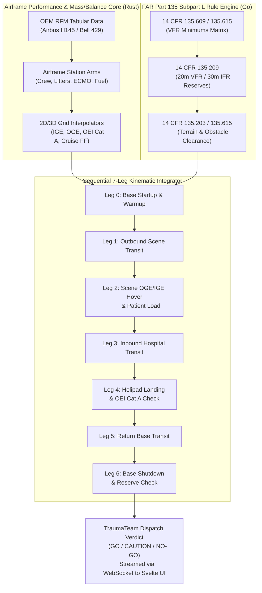

# TraumaTeam: Deterministic HEMS Mission Feasibility & Dispatch Engine

**TraumaTeam** is an aviation flight operations engineering and dispatch decision engine purpose-built for Helicopter Emergency Medical Services (HEMS) operating under **FAA 14 CFR Part 135 Subpart L** (§§ 135.601–135.621), Part 91, and Part 135 Subpart D.

Rather than relying on simplified rule-of-thumb weight or static ceiling thresholds, TraumaTeam integrates raw OEM Rotorcraft Flight Manual (RFM) multi-dimensional tabular charts with real-time aeronautical and meteorological feeds (NOAA AWC METAR, TAF, Winds Aloft, SIGMETs) and terrain profiles.

---

## System Architecture

- **Physics & Kinematics Engine (Rust / C-FFI)**: Computes In-Ground-Effect (IGE) and Out-of-Ground-Effect (OGE) hover ceilings, One-Engine-Inoperative (OEI) Category A helipad limits, continuous fuel burn schedules, and shifting Center of Gravity (CG) envelopes with zero-cost abstractions (`crates/traumateam_rfm`). Exposes a C-compatible ABI (`src/ffi.rs`) for native cross-language invocation.
- **Telemetry & Compliance (Go / gRPC / cgo)**: Ingests live NOAA weather feeds (METAR, TAF, Winds Aloft, SIGMETs), invokes the Rust physics engine natively via `cgo` (`services/weather_ingest/pkg/kinematics`), and automatically enforces FAR 135.609 / 135.615 VFR/IFR visibility minimums and mandatory fuel reserves.
- **Dispatcher Avionics UI (Svelte)**: A strict-minimalism WebSocket dashboard (`frontend/`) that pushes real-time, deterministic `GO` / `CAUTION` / `NO-GO` dispatch verdicts and precise limiting factors directly to operators.

---

## Architecture Overview



---

## Mathematical Formulation

### 1. Mass, Balance, and Fuel Depletion Curves
At every mission phase $t$, Gross Weight ($GW$) and Center of Gravity ($CG_{long}, CG_{lat}$) are computed dynamically:

$$GW(t) = W_{\text{empty}} + \sum_{i} W_{\text{payload}, i}(t) + W_{\text{fuel}}(t)$$

$$X_{CG}(t) = \frac{W_{\text{empty}} X_{\text{empty}} + \sum_{i} W_{i}(t) X_{i} + W_{\text{fuel}}(t) X_{\text{fuel}}(W_{\text{fuel}})}{GW(t)}$$

$$Y_{CG}(t) = \frac{W_{\text{empty}} Y_{\text{empty}} + \sum_{i} W_{i}(t) Y_{i} + W_{\text{fuel}}(t) Y_{\text{fuel}}(W_{\text{fuel}})}{GW(t)}$$

where $X_{\text{fuel}}(W_{\text{fuel}})$ represents the non-linear fuel tank depletion schedule (e.g. Airbus H145 main vs. supply tanks).

### 2. Barometric & Density Altitude Integration
- **Pressure Altitude (PA)**:
  $$PA = h_{\text{geom}} + \frac{T_0}{L} \left[1 - \left(\frac{QNH}{P_0}\right)^{\frac{R \cdot L}{g}}\right]$$
- **Density Altitude (DA)**:
  $$\rho = \frac{P(PA)}{R \cdot T_{\text{ambient}}}, \quad DA = \frac{T_0}{L} \left[1 - \left(\frac{\rho}{\rho_0}\right)^{\frac{1}{\frac{g}{R \cdot L} - 1}}\right]$$

### 3. Vector Wind Triangles
For flight corridor course $TC$, wind vector $(WD, WS)$, and RFM True Airspeed $TAS$:
$$\theta = WD - TC$$
$$\text{WCA} = \arcsin\left(\frac{WS \cdot \sin \theta}{TAS}\right)$$
$$TH = TC + \text{WCA}$$
$$GS = TAS \cdot \cos(\text{WCA}) - WS \cdot \cos \theta$$
$$ETE = \frac{\text{Distance}}{GS}, \quad \Delta W_{\text{fuel}} = \int \dot{m}_{f}(PA, OAT, GW) \, dt$$

---

## FAA 14 CFR § 135.615 VFR Flight Minimums Matrix

| Operating Environment | Flight Phase | Standard Minimums | With HTAWS or NVG |
| :--- | :--- | :--- | :--- |
| **Non-Mountainous, Local** | Day | 800 ft ceiling / 2 SM vis | 500 ft ceiling / 2 SM vis |
| **Non-Mountainous, Local** | Night | 1,000 ft ceiling / 3 SM vis | 1,000 ft ceiling / 3 SM vis |
| **Non-Mountainous, Cross-Country** | Day | 800 ft ceiling / 3 SM vis | 600 ft ceiling / 2 SM vis |
| **Non-Mountainous, Cross-Country** | Night | 1,000 ft ceiling / 3 SM vis | 800 ft ceiling / 3 SM vis |
| **Mountainous, Local** | Day | 800 ft ceiling / 3 SM vis | 800 ft ceiling / 3 SM vis |
| **Mountainous, Local** | Night | 1,500 ft ceiling / 3 SM vis | 1,000 ft ceiling / 3 SM vis |
| **Mountainous, Cross-Country** | Day | 1,000 ft ceiling / 3 SM vis | 1,000 ft ceiling / 3 SM vis |
| **Mountainous, Cross-Country** | Night | 1,500 ft ceiling / 5 SM vis | 1,000 ft ceiling / 3 SM vis |

---

## Verification & Benchmark Suite

TraumaTeam includes a pytest + Hypothesis test suite validating RFM chart values within $\pm 0.5\%$:
1. **Nominal Lowland HEMS Loop**: Full 7-leg mission resulting in deterministic `GO`.
2. **High-Density-Altitude Mountain Rescue**: Leadville Turquoise Lake (9,800 ft MSL, 28°C OAT, DA 13,628 ft). Flags `NO-GO` with `OGE_HOVER_SCENE_DEFICIT` and exact weight shedding recommendation.
3. **High-Headwind Fuel Boundary**: 45 kt jet streak aloft eroding reserve below 20 minutes. Flags `NO-GO` with `FAR_135_209_VFR_RESERVE_VIOLATION`.
4. **Adverse Weather Minimums**: Mountainous night VFR corridor failing ceiling/visibility minimums under § 135.615. Flags `NO-GO` with `FAR_135_615_CEILING_BELOW_MINIMUMS`.
5. **Lateral Center of Gravity Exceedance**: Concentrated asymmetric payload triggering `LATERAL_CG_RIGHT_EXCEEDED`.

Run test suite:
```bash
# Python Reference & Property Tests
python -m pytest -v
python demo_dispatch.py

# Rust RFM & FFI Core
cd crates/traumateam_rfm && cargo test

# Go Weather Ingest & FFI Bridge
cd services/weather_ingest && go test ./...

# Svelte Dispatcher Console
cd frontend && npm test
```
